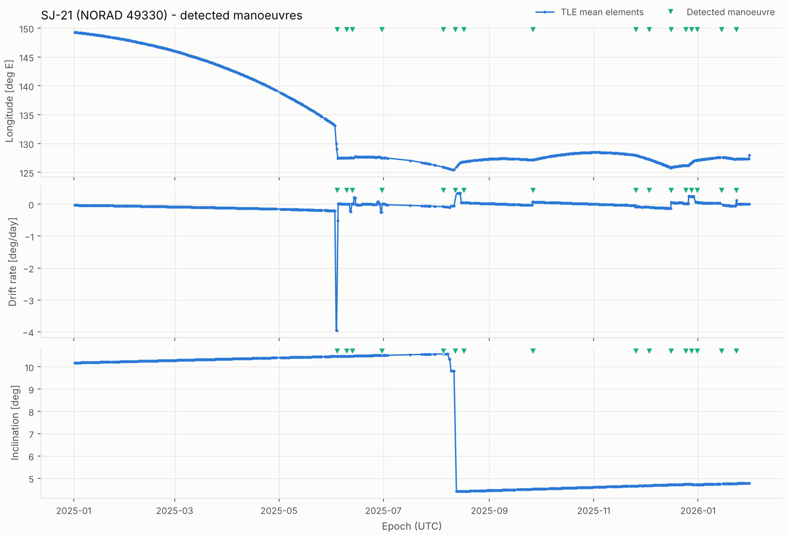
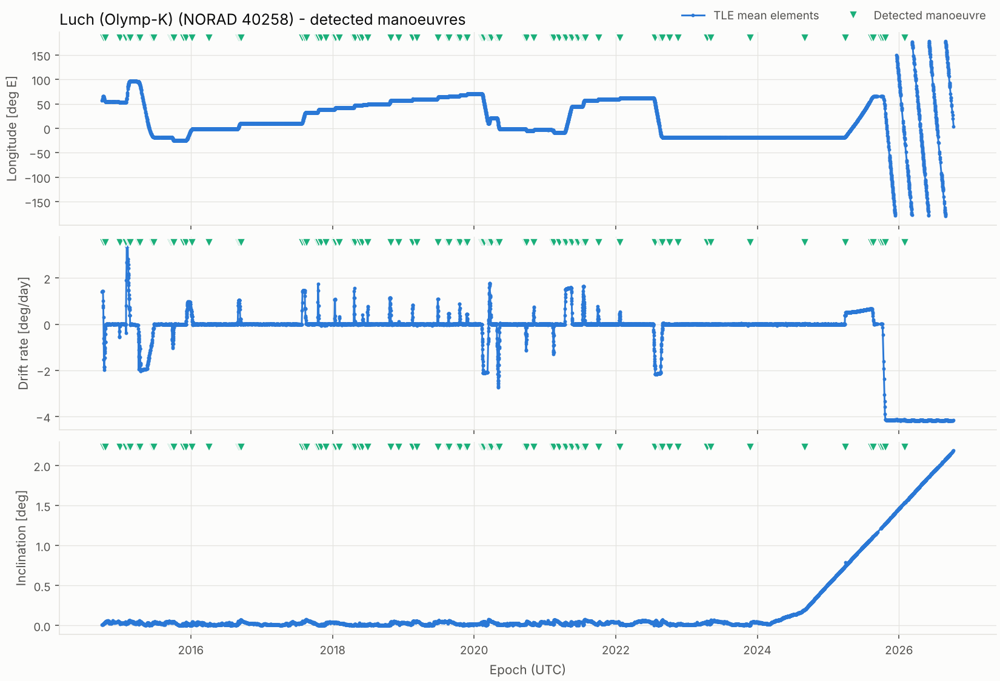
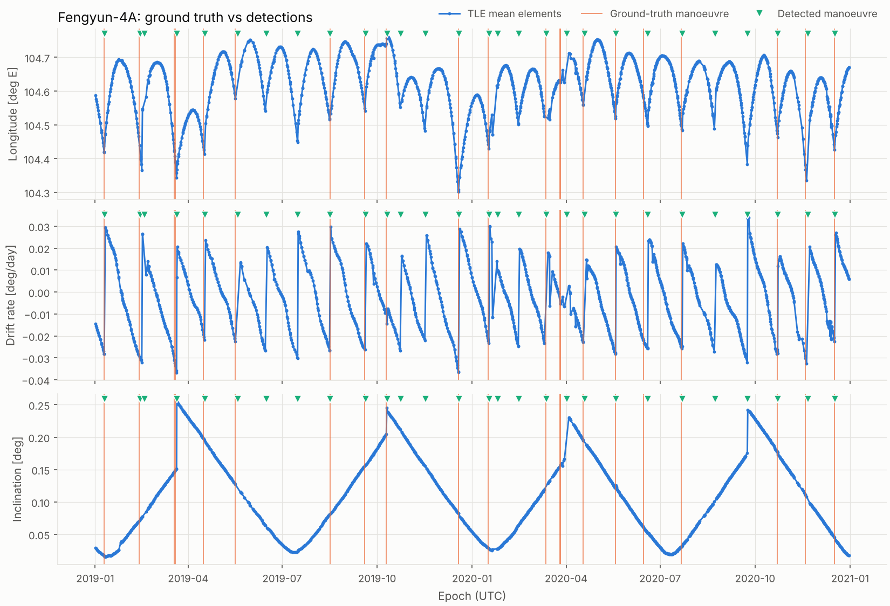

# GEO Watch

[](https://github.com/eduacu2001/geo-watch/actions/workflows/tests.yml)

**Detecting manoeuvres and proximity operations of geostationary satellites from public orbital data.**

Some satellites in geostationary orbit do more than relay TV: Russia's Luch/Olymp spacecraft
have spent a decade parking next to Western communications satellites, and China's SJ-21 towed
a dead Beidou satellite out of the GEO belt before docking with SJ-25 in 2025. This project
reconstructs that activity from the public TLE catalogue: it detects when a satellite
manoeuvres, estimates the Δv, and flags close approaches between objects - and it measures how
reliable those detections are against satellites whose real manoeuvre history is known.

> Status: **phase 2 done** - next: proximity operations (phase 3)

## What public data already shows

**SJ-21 meets SJ-25 (2025).** SJ-21 spends the first five months of 2025 drifting west from
149°E, then hops to 127.5°E in early June; SJ-25 moves there from 120°E a few days later. In
mid-August the inclination of both objects drops from 10.6° to 4.4° within a week - a plane
change of about 6°, of the order of 300 m/s, made while the two were reported to be docked.



**Luch/Olymp-K (2014-2026).** Each step in longitude is a relocation to a new slot in the GEO
belt (phase 3 will identify which satellites it parked next to). The last north-south
manoeuvre detected is in November 2023; from early 2024 the inclination grows freely
(~0.9°/year), a common way to save fuel late in a mission. In October 2025 the satellite was
raised about 330 km above GEO, where it now drifts west at 4.2°/day.



## Roadmap

| Phase | Content | Status |
|---|---|---|
| 1 | Space-Track download with local cache, mean elements, GEO longitude and drift rate, quick-look plots | done |
| 2a | Manoeuvre detection with robust change detection, Δv estimate and classification, validation against ground truth | done |
| 2b | Model-based detection: extended Kalman filter on the J22 longitude dynamics + NIS test, compared with 2a on the same benchmark | done |
| 3 | Proximity-operation detection (RIC relative motion, TLE uncertainty bands) | planned |
| 4 | Case studies: Luch/Olymp-K, Luch/Olymp 2, SJ-21 & Beidou-2 G2, SJ-21 & SJ-25 | planned |
| 5 | Interactive website with daily automatic update (GitHub Actions) | planned |

## Setup (Windows, PowerShell)

Requires Python 3.10 or newer and a free [Space-Track](https://www.space-track.org) account.

```powershell
python -m venv .venv
.venv\Scripts\Activate.ps1
pip install -e ".[dev]"
copy .env.example .env      # then edit .env with your Space-Track login
pytest                      # all tests should pass
```

If PowerShell refuses to run `Activate.ps1`, run once:
`Set-ExecutionPolicy -Scope CurrentUser RemoteSigned`.

## Usage

```powershell
python scripts/check_catalog.py            # confirm the NORAD IDs in config/objects.csv
python scripts/download_history.py         # full TLE history of every tracked object
python scripts/download_benchmark.py       # ground-truth manoeuvres for validation
python scripts/quicklook.py --norad 40258  # plot Luch (Olymp-K)
python scripts/quicklook.py --benchmark Fengyun-2F --start 2019-01-01 --end 2020-07-01
python scripts/find_object.py "INTELSAT 9" # look up IDs to add to the catalogue
python scripts/download_geo_snapshot.py    # current state of the whole GEO belt
python scripts/validate_detector.py        # score the detector against the ground truth
python scripts/detect_manoeuvres.py --plot # manoeuvre catalogue for every tracked object
python scripts/compare_detectors.py        # phase 2a vs phase 2b on the same ground truth
```

`download_history.py` is incremental: later runs only request element sets newer than those
already stored in `data/raw/gp_history/`, which keeps well inside Space-Track's usage limits.

## Manoeuvre detection: method and validation

`src/geowatch/detection.py` finds manoeuvres in the series of mean elements without any orbit
model:

1. **Signals.** East-west burns change the semi-major axis, seen as a step in the longitude
   drift rate; north-south burns change the inclination vector.
2. **Bad-TLE rejection.** Element sets that disagree with both neighbours, while the
   neighbours agree with each other, are removed first.
3. **Two-window jump.** At each gap between element sets, lines are fitted to the 6 sets
   before and the 6 after; the jump is their difference at the gap. Natural evolution is
   linear over a few days and cancels out; a burn does not.
4. **Robust significance.** Each jump is divided by the local noise of the jump series
   (rolling median absolute deviation). Detections need more than 8 robust standard
   deviations and at least 0.01 deg/day (~3 cm/s) or 0.03 deg (~1.6 m/s).
5. **Δv and type.** Δv ≈ 2.84 m/s per deg/day of drift change (tangential burn) and
   v·Δi for plane changes; each event is labelled station-keeping, drift start/stop/change or
   north-south.

**Validation** against the ground truth of five Fengyun satellites (2011-2022), with the
matching rules spelled out in `src/geowatch/validation.py`:

| Satellite | Labelled manoeuvres | Found | Unmatched detections | Precision | Recall |
|---|---|---|---|---|---|
| Fengyun-2D | 22 | 19 | 2 | 0.90 | 0.86 |
| Fengyun-2E | 48 | 47 | 4 | 0.92 | 0.98 |
| Fengyun-2F | 66 | 64 | 11 | 0.85 | 0.97 |
| Fengyun-2H | 12 | 11 | 1 | 0.92 | 0.92 |
| Fengyun-4A | 45 | 42 | 11 | 0.79 | 0.93 |
| **Total** | **193** | **183** | **29** | **0.86** | **0.95** |



What the numbers hide:

- **TLEs react late.** Detections come a median 0.7 days after the real burn (90th percentile
  2.2 days), because the catalogue's orbit fits need several post-burn observations. The
  matching window therefore accepts detections up to 4 days late but only 1 day early.
- **The ground truth is incomplete.** 21 of the 29 unmatched detections are more than a week
  from any labelled manoeuvre and as large as the labelled ones - for example a 0.4°
  inclination change on Fengyun-4A on 2020-09-23, clearly visible in the data. Precision is
  therefore a lower bound. Of the other 8: 3 are labelled burns detected 4.6-5.8 days late
  (after gaps in the TLE record), 2 come 1.7 days before a labelled burn, and 3 are small
  steps (below 0.02 deg/day) that may be genuine false alarms.
- **Parameters were chosen on the same five satellites** (window 6, threshold 8). Results
  change little between thresholds 6 and 12, but an independent test set would be better.

## Phase 2b: Kalman-filter detector

`src/geowatch/kalman.py` replaces the statistics of phase 2a with a dynamical model:

- **East-west: extended Kalman filter.** State [longitude, drift, bias]. The drift changes
  under the J22 tesseral harmonic, a(λ) = −K sin 2(λ − 75.07°), which pulls GEO satellites
  towards 75°E and 105°W; the bias state absorbs what J22 leaves out. The dynamics are
  non-linear in longitude, so the covariance is propagated with the Jacobian of each
  integration step.
- **North-south: linear Kalman filter** on the inclination vector (constant-rate model).
- **Detection:** the normalised innovation squared (NIS) of each new TLE is tested against a
  χ² gate (2 dof, false-alarm probability 1e-6). One TLE above the gate is treated as a bad
  TLE; two in a row are a manoeuvre, and the filter restarts from the new measurement.

Same benchmark, same matching rules (`python scripts/compare_detectors.py`):

| Detector | Found | Unmatched | Precision | Recall | F1 | Median lag |
|---|---|---|---|---|---|---|
| 2a two-window statistics | 183 / 193 | 29 | 0.86 | 0.95 | 0.90 | 0.70 days |
| 2b Kalman filters | 183 / 193 | 40 | 0.82 | 0.95 | 0.88 | 0.65 days |

The filter reacts slightly earlier (it needs two post-burn TLEs instead of a window of six)
at the cost of a few more alarms. Its mean NIS is 1.7 (east-west) and 1.2 (north-south)
against an ideal of 2, so it is consistent and slightly conservative.

Two lessons from building it:

- **TLE errors are correlated in time.** Consecutive TLEs come from overlapping orbit
  determination arcs, so the scatter between them underestimates the real prediction error.
  The measurement noise is estimated from the data but given physical floors (0.01° in
  longitude, 0.002°/day in drift); without them the filter fires constantly.
- **The detectors disagree on Luch/Olymp-K** (110 manoeuvres for 2a, 388 for 2b): its
  drift jumps by 0.01-0.02°/day every few days, which the filter treats as small burns and
  the robust statistics treat as noise. Whether these are real micro-manoeuvres is an open
  question for the case study.

## Method notes

- **Mean elements, not osculating states.** Following Shorten et al. (2023), orbit changes are
  tracked with the mean elements published in each TLE. Propagating TLEs with SGP4 and
  comparing osculating states sampled once a day adds short-period terms that look like noise
  or like fake manoeuvres.
- **Longitude drift rate** is computed by propagating each element set half a sidereal day
  either side of its epoch with SGP4/SDP4. Spanning one full orbit cancels the daily
  oscillation, and SDP4 keeps the deep-space resonance terms. On Fengyun-2F it matches the drift
  observed between consecutive TLEs to about 0.002 deg/day; a J2-only estimate is biased by
  about 0.007 deg/day.

## Project structure

```
config/objects.csv        tracked objects (inspectors, targets, validation satellites)
src/geowatch/
    config.py             paths and credentials
    catalog.py            loading the object list
    spacetrack_io.py      Space-Track queries and local Parquet cache
    elements.py           mean elements, GEO longitude, drift rate, e/i vectors
    benchmark.py          ground-truth manoeuvre dataset
    detection.py          manoeuvre detection, delta-v and classification (phase 2a)
    kalman.py             Kalman-filter manoeuvre detection (phase 2b)
    validation.py         matching detections to ground truth
    plots.py              quick-look figures
scripts/                  command-line entry points
tests/                    pytest suite (no network needed)
docs/img/                 figures used in this README (derived results only)
data/, figures/           generated locally, not committed
```

## Data and credits

- Orbital data: [Space-Track.org](https://www.space-track.org) (18th/19th Space Defense
  Squadron). Raw data is not redistributed in this repository, in line with the Space-Track
  user agreement; only derived results are published.
- Ground-truth manoeuvres: D. Shorten, Y. Yang, J. Maclean, M. Roughan, *Wide-scale Monitoring
  of Satellite Lifetimes: Pitfalls and a Benchmark Dataset*,
  [arXiv:2212.08662](https://arxiv.org/abs/2212.08662) -
  [dataset](https://github.com/dpshorten/TLE_observation_benchmark_dataset). Manoeuvre times
  originate from the International DORIS Service and China's National Satellite
  Meteorological Center.
- Propagation: [sgp4](https://pypi.org/project/sgp4/) by Brandon Rhodes; Space-Track client:
  [spacetrack](https://pypi.org/project/spacetrack/).

Author: Eduardo Acuña
